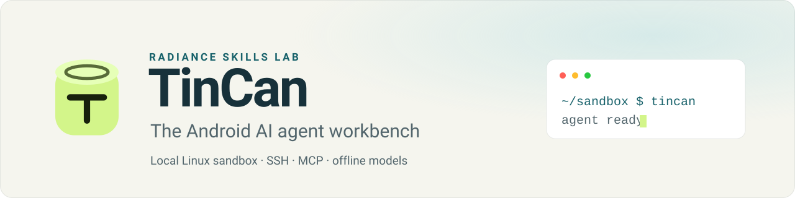

<picture>
  <source media="(prefers-color-scheme: dark)" srcset="assets/hero-dark.svg">
  
</picture>

<p align="center">
  <a href="https://github.com/radianceskills-dev/tincan-releases/releases"></a>
  <a href="https://github.com/radianceskills-dev/tincan-releases/releases"></a>
  <a href="https://github.com/radianceskills-dev/tincan-releases/stargazers"></a>
  
  
</p>

**TinCan turns an Android phone or tablet into a self-contained AI engineering workbench.** It pairs a real on-device Alpine Linux sandbox and multi-server SSH with MCP tools, reusable skills, offline GGUF models, and zero-context-loss switching across cloud OAuth and bring-your-own-key providers — free, ad-free, and local-first.

<p align="center">
  <a href="https://github.com/radianceskills-dev/tincan-releases/releases/download/v2.23.10/TinCan-v2.apk"></a>
</p>

<p align="center">
  <a href="https://github.com/radianceskills-dev/tincan-releases/releases/download/v2.23.10/TinCan-v2-Android-APK.zip">ZIP archive</a> ·
  <a href="https://github.com/radianceskills-dev/tincan-releases/releases">All releases</a> ·
  <a href="https://tincan.rdskills-lab.com/">Website</a> ·
  <a href="https://tincan.rdskills-lab.com/experience/">Interactive tour</a>
</p>

## Current Release

| Can label | |
| :-- | :-- |
| **Version** | 2.23.10 |
| **Build** | 85 · `com.shunmin.tincan` |
| **Net weight** | APK 60.0 MB · ZIP 57.4 MB |
| **Requires** | Android 7.0+ (API 24) · ARM64 (`arm64-v8a`) |
| **Seal (SHA-256)** | `036cde9b…01f46c79` · full checksums below |

## What’s Inside

| | |
| :-- | :-- |
| 🐧 **Sandbox & SSH** | On-device Alpine Linux with `/mnt/shared` storage access, plus multi-server SSH and durable background jobs (Conch) that survive disconnects. |
| 🧠 **Models & routing** | Offline GGUF inference (llama.cpp) and seamless switching across ChatGPT/OpenAI, Antigravity, Puter, OpenRouter OAuth and custom BYOK keys — in the same thread, no context loss. |
| 🔌 **MCP & skills** | Model Context Protocol servers (HTTP/SSE and stdio) and installable, pinnable `skills.sh` workflows. |
| 🎛️ **Modes & memory** | Plan (read-only), Build, and Pro multi-pass reasoning; two-tier persistent memory and full-text past-conversation search. |
| 🎙️ **Multimodal** | On-device Whisper speech-to-text, system/AI text-to-speech, PDF page-range inspection, and video frame slicing. |
| ⏱️ **Automation** | Cron background tasks, in-chat execution loops, and interactive HTML/JS artifacts rendered right in chat. |

<details>
<summary><b>Install on Android</b></summary>

<br>

1. Download [`TinCan-v2.apk`](https://github.com/radianceskills-dev/tincan-releases/releases/download/v2.23.10/TinCan-v2.apk), or the [ZIP archive](https://github.com/radianceskills-dev/tincan-releases/releases/download/v2.23.10/TinCan-v2-Android-APK.zip) and extract `TinCan-v2.apk`.
2. Tap the APK. If prompted, allow installs from your browser or file manager (**Install unknown apps**).
3. Open TinCan and pick a provider: sign in with OAuth, paste a BYOK key, or load a local GGUF model.


</details>

<details>
<summary><b>Verify Your Download</b></summary>

<br>

```text
Version:  2.23.10 (versionCode 85)
Package:  com.shunmin.tincan
APK:      TinCan-v2.apk (59,987,465 bytes)
SHA-256:  036cde9b53dcd1179b35126e525a55fbef37f41f601bdbb09b7cb8b401f46c79

ZIP:      TinCan-v2-Android-APK.zip (57,445,319 bytes)
SHA-256:  48f482c012789e18db3859703f62f75c118efecbaa87a503059bd09ff9f6d588
```

```sh
sha256sum TinCan-v2.apk
```

</details>

<details>
<summary><b>Full Capability List</b></summary>

<br>

- Embedded Linux sandbox with full device-storage access (`/mnt/shared`).
- Multi-server SSH manager with durable background execution (Conch).
- Zero-context-loss switching across OAuth, BYOK, and offline GGUF models in one thread.
- MCP client with HTTP/SSE and stdio transports.
- `skills.sh` manager with pinned versions and integrity checks.
- Plan, Build, and Pro modes; two-tier memory; cron tasks and loops.
- Interactive artifacts: HTML/CSS/JS dashboards, diagrams, and calculators in chat.
- On-device Whisper STT and system/AI TTS.
- PDF and image inspection; video frame slicing.
- Sandbox exports, attachment handling, and backup inclusion.
- Multilingual UI: English, Arabic (RTL), Urdu (RTL), Hindi, Spanish, French, Chinese.

</details>

<details>
<summary><b>AI Providers</b></summary>

<br>

- **OAuth sign-in:** ChatGPT/OpenAI, Antigravity, Puter, OpenRouter.
- **Bring your own key:** any HTTPS OpenAI-compatible endpoint (OpenRouter, OpenAI, and others).
- **Offline:** local GGUF models via llama.cpp and on-device Whisper — no network, no markup.

</details>

## Links

| | |
| :-- | :-- |
| 🌐 **Website** | [tincan.rdskills-lab.com](https://tincan.rdskills-lab.com/) |
| 🧭 **Interactive tour** | [tincan.rdskills-lab.com/experience](https://tincan.rdskills-lab.com/experience/) |
| ⭐ **Reviews** | [Read & share reviews](https://tincan.rdskills-lab.com/review/) |
| 🧪 **Radiance Skills Lab** | [rdskills-lab.com](https://rdskills-lab.com/) |
| ✉️ **Support** | [support@rdskills-lab.com](mailto:support@rdskills-lab.com) |

---

<p align="center">
  <sub>Free · ad-free · local-first — sealed with care by <a href="https://rdskills-lab.com/">Radiance Skills Lab</a> 🥫</sub>
</p>
